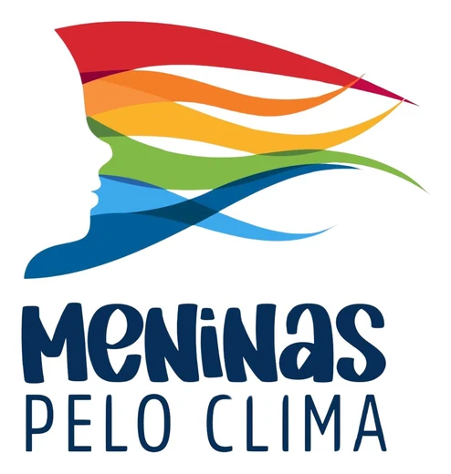

# Alag@u

**Alagou? Avisou!** — Monitoramento Comunitário de Alagamentos

Uma iniciativa do projeto Meninas pelo Clima — LabPENSo/UERJ.

<p>
  
  &nbsp;&nbsp;
  
</p>

## Status

- Fases 0 e 1 (diagnóstico e arquitetura): aprovadas.
- Fase 2 (estrutura visual): concluída.
- **Pacote A** (itens sem banco de dados: responsividade, selo EXEMPLO, app instalável/offline, busca de endereços e limites, trecho da rua, conteúdo educativo, avisos do INMET e previsão, privacidade, link direto + logomarcas): **concluído (0.12.0), aguardando validação** — ver [docs/pacote-a](docs/pacote-a/README.md).
- Ainda não há banco de dados: os relatos de demonstração são fictícios e sinalizados (faixa amarela e selo EXEMPLO).

**Demonstração online:** https://nickpw00.github.io/Alagou_project/ (dados fictícios; publicada automaticamente a cada push — ver [guia](docs/publicacao.md)).

<p align="center">
  <a href="https://nickpw00.github.io/Alagou_project/">
    
  </a>
  <br>
  <sub>Aponte a câmera do celular para abrir a demonstração. Versão para impressão: <a href="docs/qrcode-site.png">docs/qrcode-site.png</a></sub>
</p>

Documentos:
- [Diagnóstico e arquitetura](docs/00-fase-0-1-diagnostico-e-arquitetura.md)
- [Fase 2 — estrutura visual e testes](docs/01-fase-2-estrutura-visual.md)
- [Plano das próximas etapas](docs/02-plano-proximas-etapas.md)
- [Pacote A — documentos de cada item](docs/pacote-a/README.md)
- [Processo de desenvolvimento](docs/processo-desenvolvimento.md)
- [Changelog](CHANGELOG.md)
- [Pendências](docs/pendencias.md)
- [Guia de marca](docs/marca/README.md)
- [Publicação da demonstração](docs/publicacao.md)

## Desenvolvimento

Requisitos: Node.js 22+.

```bash
npm install
cp .env.example .env.local
npm run dev          # servidor local
npm test             # testes unitários
npm run test:e2e     # testes ponta a ponta (Playwright)
npm run build        # versão de produção em dist/
```

Tecnologias: React, TypeScript, Vite, Tailwind CSS, MapLibre GL (mapa base © colaboradores do OpenStreetMap).

> O Alag@u é uma plataforma comunitária de informação e ciência cidadã. Seus registros não substituem os alertas, avaliações e orientações dos órgãos de Defesa Civil.
> Em caso de emergência, ligue 199 (Defesa Civil) ou 193 (Bombeiros).
